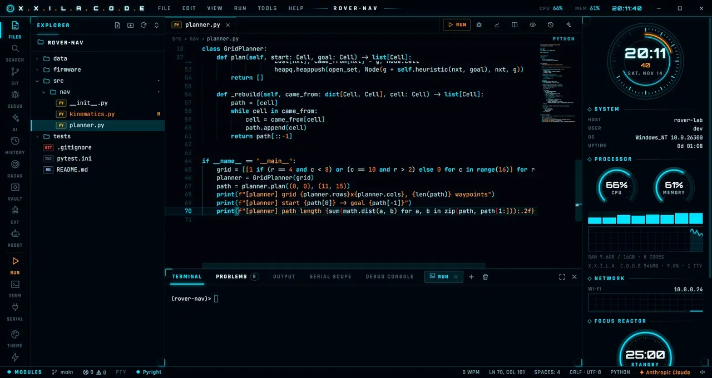
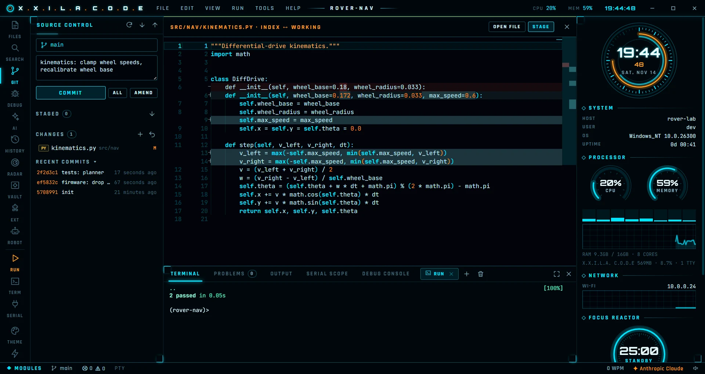
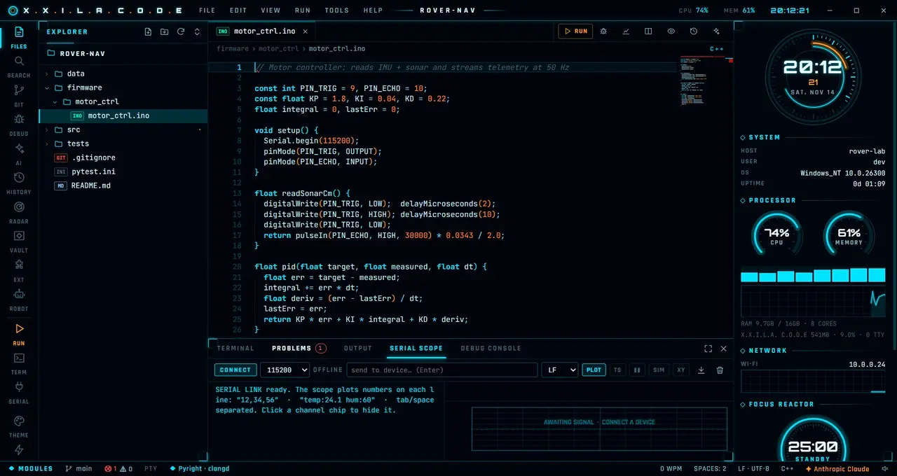
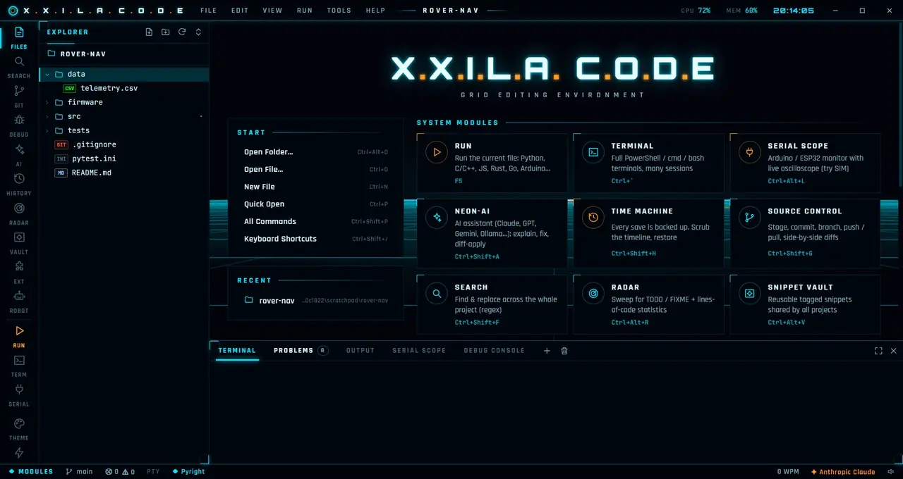
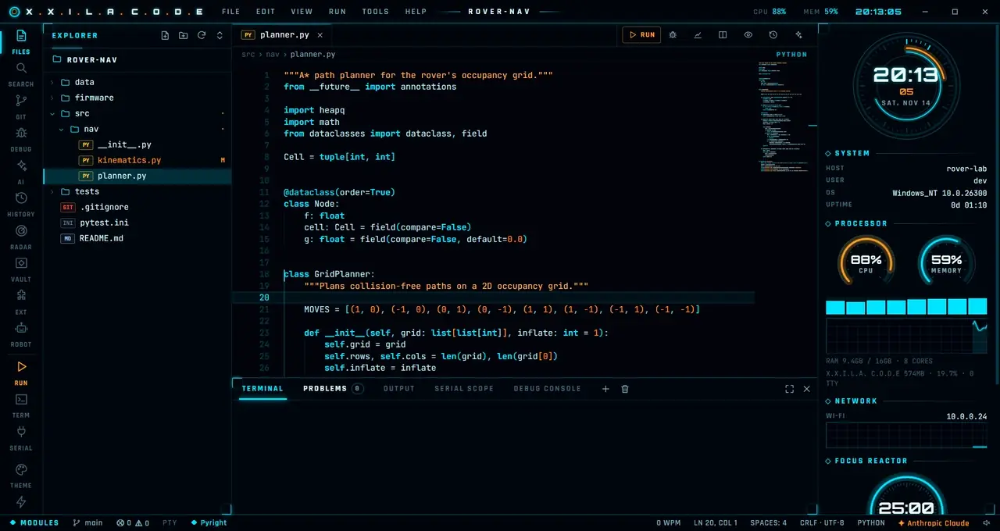
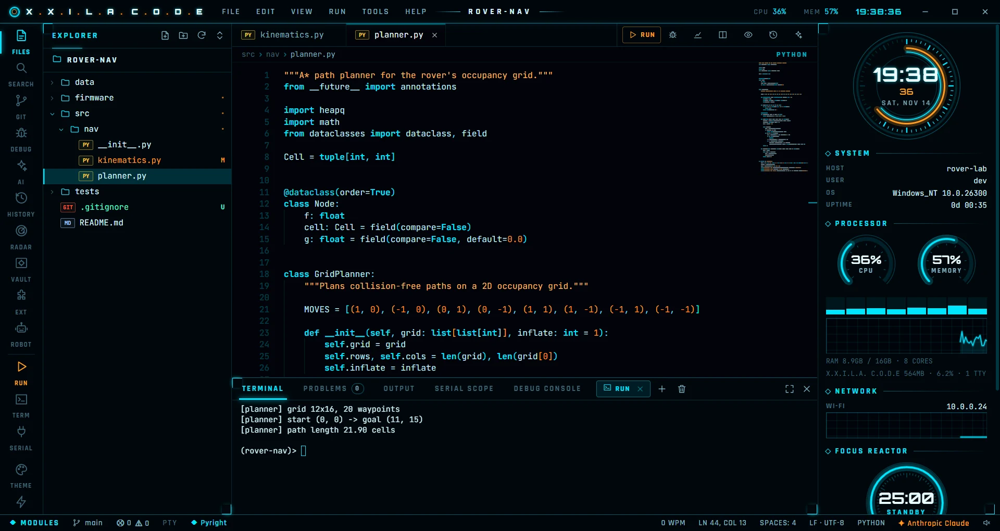
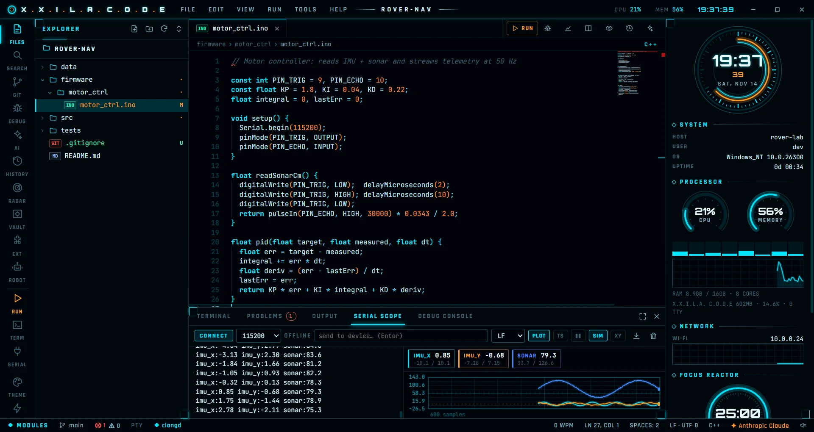
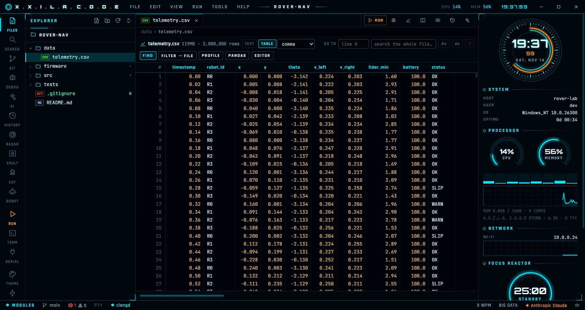

<div align="center">


# X.X.I.L.A. C.O.D.E

**A sci-fi code editor with real IDE power.**<br>
Language servers, a debugger, the AI assistant of your choice, a big-data viewer and robotics tools, wrapped in a neon grid.

[](https://github.com/Matthew-Dam/xxila-code/releases/latest)
[](https://github.com/Matthew-Dam/xxila-code/releases)


**[Website](https://matthew-dam.github.io/xxila-code/)** · **[Download](#download)** · **[Features](#features)** · **[Install help](#install-help)**

<br>



<sub>Writing and running a Python path planner. <a href="https://matthew-dam.github.io/xxila-code/media/code.mp4">Watch in HD (MP4)</a></sub>

</div>

---

## Download

| System | Download |
|---|---|
| **Windows** 10 / 11 (64-bit) | [**XXILA-CODE-Setup-x64.exe**](https://github.com/Matthew-Dam/xxila-code/releases/latest/download/XXILA-CODE-Setup-x64.exe) |
| **macOS**, Apple Silicon (M1–M4) | [XXILA-CODE-mac-arm64.dmg](https://github.com/Matthew-Dam/xxila-code/releases/latest/download/XXILA-CODE-mac-arm64.dmg) |
| **macOS**, Intel | [XXILA-CODE-mac-x64.dmg](https://github.com/Matthew-Dam/xxila-code/releases/latest/download/XXILA-CODE-mac-x64.dmg) |
| **Linux**, AppImage (most distros) | [XXILA-CODE-x86_64.AppImage](https://github.com/Matthew-Dam/xxila-code/releases/latest/download/XXILA-CODE-x86_64.AppImage) |
| **Linux**, Ubuntu / Debian / Mint | [xxila-code_amd64.deb](https://github.com/Matthew-Dam/xxila-code/releases/latest/download/xxila-code_amd64.deb) |

These links always point to the newest version. Checksums and older versions are on the [Releases page](https://github.com/Matthew-Dam/xxila-code/releases). No account or sign-up is needed.

---

## Features

### A real editor with code intelligence
Built on **Monaco**, the editor engine inside VS Code, with language servers for **Python, C/C++, Rust, Go** and more: completion, go-to-definition, rename and live diagnostics. It also includes a **Python debugger** with breakpoints, watch expressions and the call stack, plus full **PowerShell, cmd and bash terminals**.



<sub>Source control: reviewing a side-by-side diff while the tests pass in the terminal.</sub>

### Robotics and serial, built in
Write firmware, flash it and watch your sensors live, without switching apps. **Serial Scope** plots incoming values as a live oscilloscope, with an **XY mode** and CSV export. It also supports **Arduino CLI, PlatformIO, MicroPython** (ESP32, Pico) and **ROS 2** tools. Use **SIM** mode to try it without any hardware.



<sub>Serial Scope streaming IMU and sonar readings, then switching to XY mode. <a href="https://matthew-dam.github.io/xxila-code/media/scope.mp4">Watch in HD (MP4)</a></sub>

### Open data files of any size
Files over 50 MB open in the **Big Data Viewer**, which streams from disk instead of loading the whole file into memory. It has a table view, whole-file search, go to line, filtering matches into a new file, column profiling and a hand-off to pandas.



<sub>Searching a 119 MB, 2,000,000-row telemetry log: 4,726 matches in about 2 seconds. <a href="https://matthew-dam.github.io/xxila-code/media/bigdata.mp4">Watch in HD (MP4)</a></sub>

### Make it yours
More than 15 built-in themes, plus themes and snippets from the **Open VSX** marketplace. The boot sequence, interface sounds and glow effects can each be switched off.



<sub>Cycling through the built-in themes. <a href="https://matthew-dam.github.io/xxila-code/media/themes.mp4">Watch in HD (MP4)</a></sub>

### And more

| | |
|---|---|
| **Your AI, your choice** | Claude, GPT, Gemini, Mistral, Groq, DeepSeek, OpenRouter, or fully local with Ollama and LM Studio. Inline completions included. |
| **Time Machine** | Every save is kept. Scrub back through a file's history and restore any version. |
| **Source control** | Stage, commit, branch, push and pull, with side-by-side diffs and inline blame. |
| **Live system HUD** | CPU, memory, network and a focus timer at the side of your code. |
| **Extensions** | Install from Open VSX, or write your own sandboxed plugins. |
| **Private by design** | No account, no analytics, no tracking. Your code stays on your computer. |

<details>
<summary><b>More screenshots</b></summary>
<br>







</details>

---

## Install help

<details>
<summary><b>Windows says “Windows protected your PC”</b></summary>

The installer is new and not yet widely downloaded, so SmartScreen shows a warning. Click **More info** → **Run anyway**.
</details>

<details>
<summary><b>macOS says the app “can’t be opened” or “can’t be verified”</b></summary>

Drag the app into **Applications**, then **right-click it → Open → Open**. You only do this once.
On macOS 15 and newer: try to open it, then go to **System Settings → Privacy & Security** and click **Open Anyway**.
If macOS reports the app as “damaged”, run this once in Terminal:

```bash
xattr -cr "/Applications/X.X.I.L.A. C.O.D.E.app"
```
</details>

<details>
<summary><b>Linux: running the AppImage</b></summary>

```bash
chmod +x XXILA-CODE-x86_64.AppImage
./XXILA-CODE-x86_64.AppImage
```

If it complains about FUSE on Ubuntu 22.04 or newer: `sudo apt install libfuse2` (on 24.04: `libfuse2t64`).
For the .deb: `sudo apt install ./xxila-code_amd64.deb`, then launch it from your app menu.
</details>

<details>
<summary><b>Updates</b></summary>

The app checks once a day for a newer version and offers to open the download page. You can turn this off in Settings.
</details>

**Optional extras.** Each of these unlocks a feature, and the app can also install them for you:

| Feature | Install |
|---|---|
| Python intelligence | `pip install pyright` |
| Python debugger | `pip install debugpy` |
| Python formatter | `pip install ruff` |
| C / C++ / Arduino intelligence | `winget install LLVM.LLVM` |
| Arduino compile and upload | `winget install ArduinoSA.CLI` |
| ESP32 / Pico MicroPython | `pip install mpremote` |

---

## Team

| | |
|---|---|
| **Matthew Damptey** | Creator · Xxila-Tech |
| **Boachie Francis** | Contributor |
| **Fataw Musah** | Contributor |

---

<div align="center">

Free to use · © 2026 Xxila-Tech · [Privacy policy](https://matthew-dam.github.io/xxila-code/privacy.html) · [Contact](mailto:dampteymatthew13579@gmail.com)

<sub>This repository holds the website and the official installers. The application's source code is not public.</sub>

</div>
